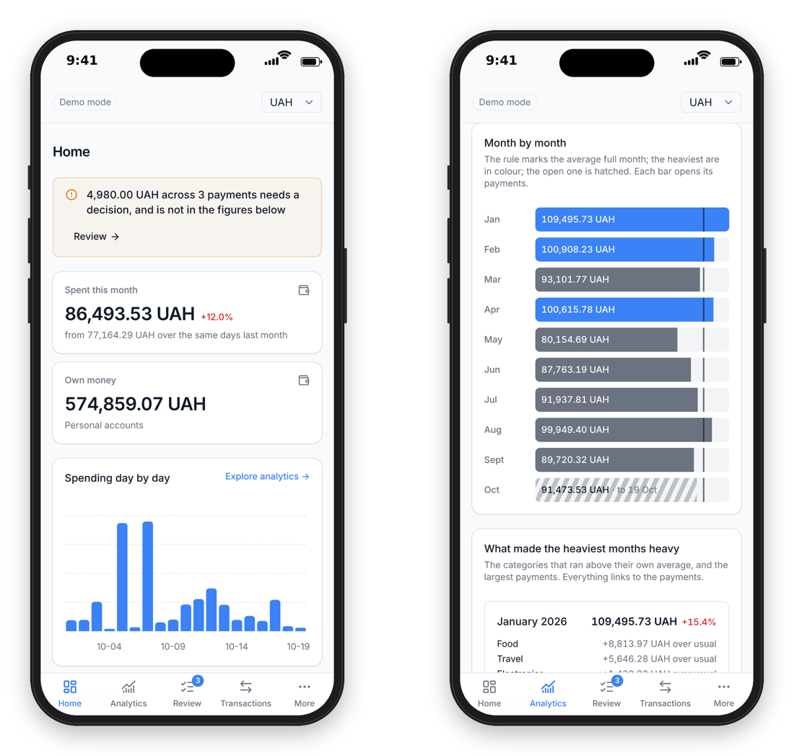

# Keepard

Family finances on your own server. Keepard gathers the accounts two people
hold in different banks and countries, works out what was really spent, and
asks in Telegram when it is not sure. Nobody else sees the data.

Keepard is a working name. The code still says Private Finances in many places.

<p align="center"></p>

## Who it is for

- Households with accounts in several countries: Monobank at home, Wise and
  Revolut abroad, a local bank where you live now.
- Couples who budget together and want to see the family's spending, not just
  their own.
- Anyone who wants the whole picture in one currency: accounts, deposits,
  broker, crypto and cash.
- People who would rather not hand their bank data to someone else's SaaS.

## What it does

- **Collects transactions by itself.** Monobank through its personal API
  token; Wise, Revolut and other European banks through
  [Enable Banking](https://enablebanking.com), which is free for your own
  accounts. Daily import, no duplicates on a repeat run.
- **Counts personal spending honestly.** Transfers between your own accounts,
  investments and refunds are not counted as spending.
- **Classifies, and asks when unsure.** Your rules first, then what it has seen
  before, then an AI suggestion within a hard monthly budget. Whatever is left
  goes to a review queue and to Telegram.
- **Analytics you can trace.** By category, period and person, in any currency
  at the day's rate. Every figure opens the payments behind it.
- **Assets over time.** Everything the household owns, valued on a date, with a
  chart.
- **A health page.** Whether each import is alive, when each bank consent
  expires, when the last backup ran.

It installs on a phone as an app, takes receipt photos from Telegram, and makes
encrypted daily backups.

## Rules it never breaks

- Bank access is read-only. There is no code for payments or transfers.
- Money is stored as whole minor units, never as floating-point numbers.
- The AI suggests a category; plain code computes every total. The model has
  no access to credentials, the database or a shell.
- A person's decision outranks every rule and suggestion.
- Unresolved money stays visible instead of dropping out of the total.

The full list is in [AGENTS.md](AGENTS.md).

## Try the demo

The demo needs no bank and no keys. It opens a workspace with sixteen months of
an invented household. You need Node.js 24 and pnpm.

```sh
pnpm install --frozen-lockfile
pnpm demo:seed
pnpm demo
```

Open http://127.0.0.1:3300. See [the showcase](docs/showcase.md).

## Running your own

Today it runs as a Docker Compose stack (the application, PostgreSQL, the
Telegram worker and a job runner for imports, with timers on the host) behind a
reverse proxy, with configuration files in `/etc/private-finances/`. [Containers](docs/containers.md) describes the stack,
[credentials](docs/credentials.md) the keys it needs,
[bank connectors](docs/bank-connectors.md) and
[Telegram setup](docs/telegram-setup.md) the integrations.

### Before you fork

It was built for one household and has not yet been installed by anyone else.
Expect to read code. What will get in your way today:

- **Exactly two people.** The two members are built in. Their sign-in comes
  from `RODION_EMAIL`/`RODION_PASSWORD` and `KATYA_EMAIL`/`KATYA_PASSWORD`, and
  their display names are set in `src/account-names.ts`.
- **One time zone.** Months and days are counted in `Europe/Riga`, which has
  the same offset as Kyiv all year. Elsewhere, month boundaries will be off by
  a few hours.
- **No configuration templates yet.** The Compose file reads `app.env`,
  `db.env`, `telegram.env`, `sync.env` and `showcase.env`, and their variables
  are described across the docs rather than in example files.
- **The setup guides describe a migration**, not a first install on a fresh
  server.
- **Ukrainian banks: Monobank only.** The interface is in English.

Making these configurable is the next piece of work. Issues and pull requests
are welcome. Please never paste keys, tokens or real bank data into either.

## How it was built

Keepard was written by AI coding agents under one person's direction in nine
days, and has been in daily family use since. The repository keeps the working
rules the agents follow, the design system they compose screens from, and the
checks that hold them to it. See [how agents work on this
project](docs/agent-development-model.md). The approach grew into the
[InHouse AI Starter Kit](https://github.com/brocoders/inhouse-ai-starter-kit).

## Documentation

- [Current state](docs/STATUS.md) and [roadmap](docs/roadmap.md)
- [Spending, review and evidence workflows](docs/spending-workflows.md)
- [Receipt photos](docs/receipts.md)
- [Credential sources, storage and renewal](docs/credentials.md)
- [Telegram setup](docs/telegram-setup.md)
- [Bringing it up: laptop, release, and rebuilding from nothing](docs/running.md)
- [Containers](docs/containers.md)
- [Development and tests](docs/development.md)
- [The showcase workspace](docs/showcase.md)
- [Application architecture and limitations](docs/adr/0002-synthetic-application.md)
- [Agent working agreement](AGENTS.md)
- [How agents work on this project](docs/agent-development-model.md)
- [Requirements](docs/requirements.md)
- [Bank integration decisions](docs/integrations.md)
- [Deployment contract](docs/operations.md)
- [What the production server needs](docs/server-requirements.md)
- [Monitoring contract](docs/observability.md)
- [The landing page](site/README.md)

The original Ukrainian specification remains unchanged in the repository root.

## Contact

Rodion Salnik, CTO and co-founder of [Brocoders](https://brocoders.com):
rodion@brocoders.com or [LinkedIn](https://www.linkedin.com/in/rodik/). Write if you want to run your own and get stuck, or want
to build something like this together.

## License

[GNU Affero General Public License v3.0](LICENSE). You may use, change and
share it. If you run a changed version as a service for others, you must
publish your changes under the same license.

Copyright © 2026 Rodion Salnik.
